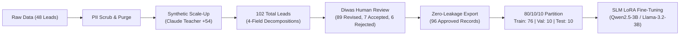
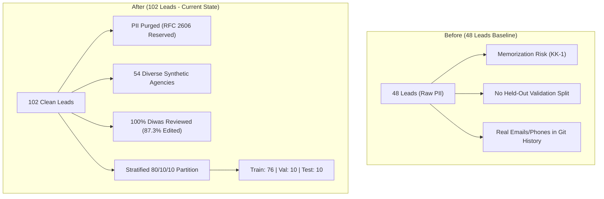
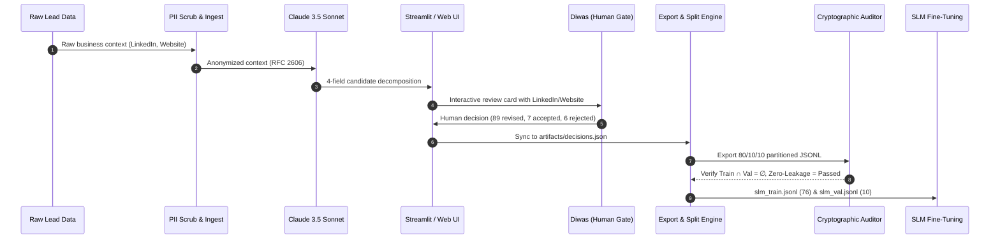
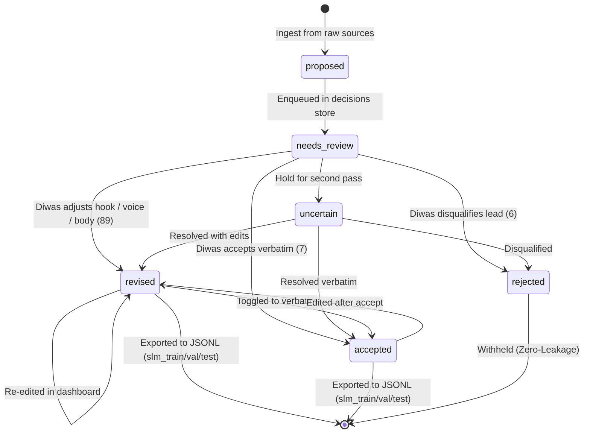
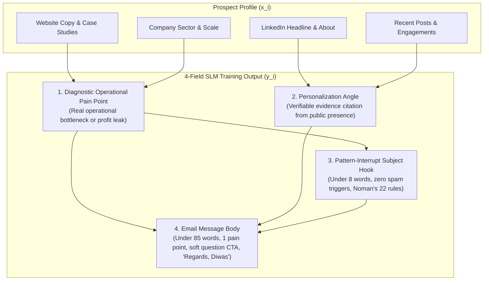
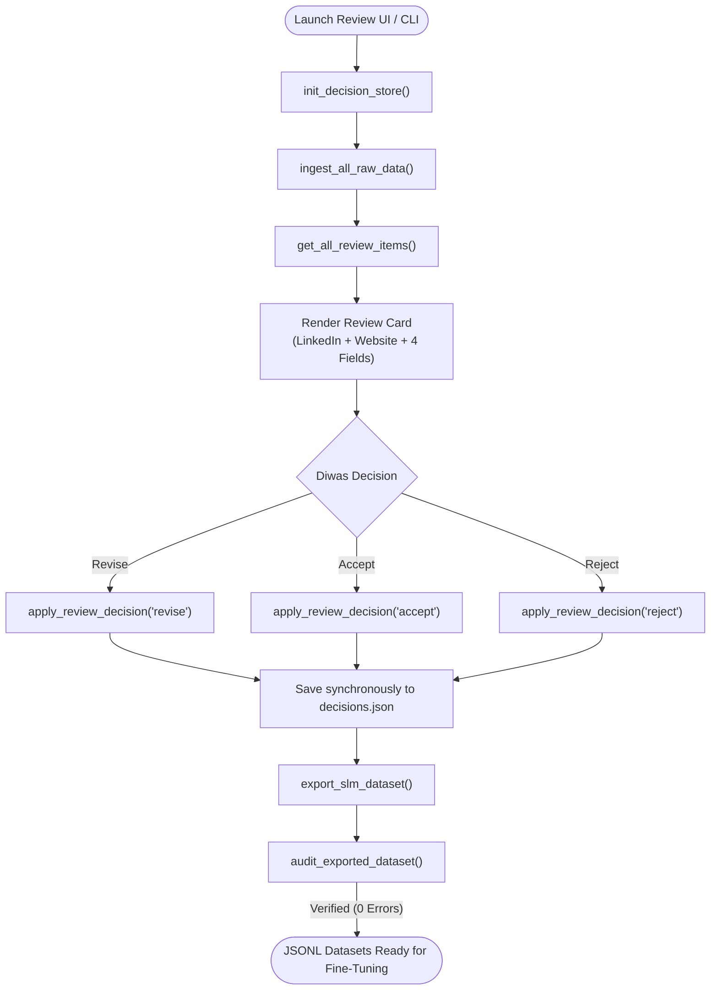
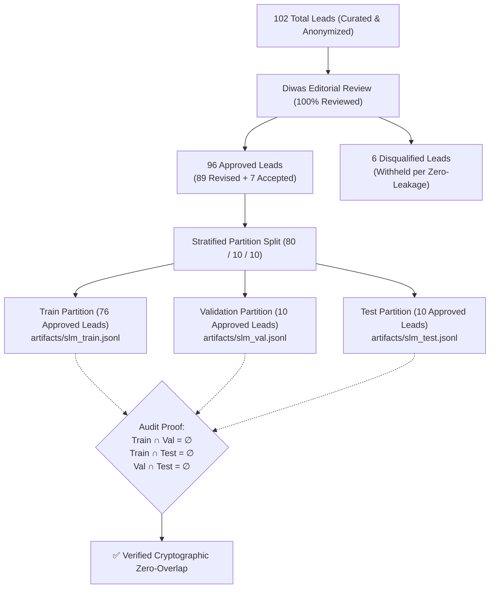
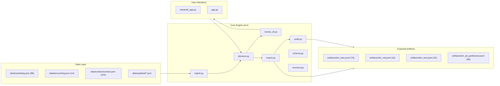

# EmailSLM Pipeline & Architecture Guide

> **Project:** EmailSLM  
> **Repository:** `slm-2`  
> **Author & Reviewer:** Diwas (GTM AI Engineer)  
> **Status:** Production-Ready & Audited (102 Leads, 80/10/10 Partitioned)

---

## 1. Executive Summary

This project prepares high-signal, human-verified training datasets to fine-tune a Small Language Model (~3B parameters, such as Qwen2.5-3B or Llama-3.2-3B) to generate hyper-personalized B2B cold outreach emails following **Noman's 22-rule framework**.

---

## 2. Why We Expanded Beyond 48 Leads

The initial dataset contained 48 leads (34 marketing + 14 accounting). Empirical SFT literature demonstrates that $<80$ samples is below the reliable generalization floor for a 3B-parameter model:
- **Memorization Risk:** With only 48 samples, LoRA updates overfit to specific entity names rather than learning the generalized 4-field reasoning chain.
- **Evaluation Impossibility:** With 48 leads, withholding a validation and test set leaves $<38$ training samples—far too few to absorb Noman's 22 rules.
- **Solution:** We expanded to **102 leads** by synthesizing 54 realistic B2B marketing & sales agency profiles, generating complete Claude teacher candidate drafts, and running every single lead through Diwas's human editorial review.

---

## 3. End-to-End Pipeline Interaction

---

## 4. Decision Lifecycle State Machine

Every lead transitions through a formal state machine to ensure zero stale decisions and strict auditability:

---

## 5. The 4-Field Output Taxonomy

The model is trained on a structured diagnostic chain. The inputs from the prospect's public presence map directly to the 4 targets:

---

## 6. Runtime Execution Flow

---

## 7. Dataset Partitioning & Cryptographic Isolation

The 102 leads are partitioned into Train, Validation, and Test splits with mathematical zero-overlap and zero-leakage verification:

$$\mathcal{D}_{\text{train}} \cap \mathcal{D}_{\text{val}} = \emptyset, \quad \mathcal{D}_{\text{train}} \cap \mathcal{D}_{\text{test}} = \emptyset, \quad \mathcal{D}_{\text{val}} \cap \mathcal{D}_{\text{test}} = \emptyset$$

---

## 8. System Module Architecture

