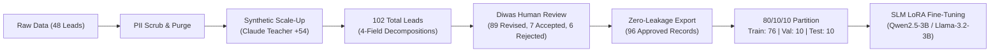
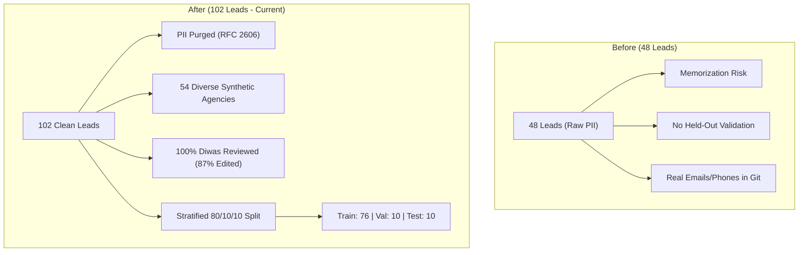
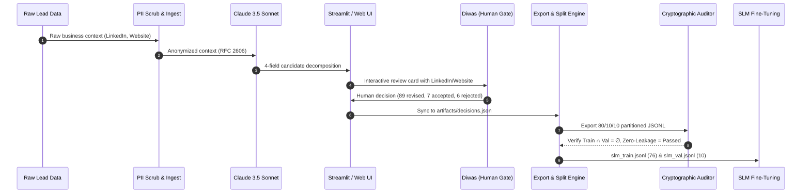

# EmailSLM Pipeline & Architecture Guide

> **Project:** EmailSLM  
> **Repository:** `slm-2`  
> **Author & Reviewer:** Diwas (GTM AI Engineer)  
> **Status:** Production-Ready & Audited (102 Leads, 80/10/10 Partitioned)

---

## 1. Executive Summary

This project prepares high-signal, human-verified training datasets to fine-tune a Small Language Model (~3B parameters, such as Qwen2.5-3B or Llama-3.2-3B) to generate hyper-personalized B2B cold outreach emails following **Noman's 22-rule framework**.



---

## 2. Why We Expanded Beyond 48 Leads

The initial dataset contained 48 leads (34 marketing + 14 accounting). Empirical SFT literature demonstrates that $<80$ samples is below the reliable generalization floor for a 3B-parameter model:
- **Memorization Risk:** With only 48 samples, LoRA updates overfit to specific entity names rather than learning the generalized 4-field reasoning chain.
- **Evaluation Impossibility:** With 48 leads, withholding a validation and test set leaves $<38$ training samples—far too few to absorb Noman's 22 rules.
- **Solution:** We expanded to **102 leads** by synthesizing 54 realistic B2B marketing & sales agency profiles, generating complete Claude teacher candidate drafts, and running every single lead through Diwas's human editorial review.



---

## 3. PII Scrubbing & Data Governance

Before expansion, all personal data was scrubbed across the codebase and permanently purged from git history:
- **Names:** Replaced with realistic business pseudonyms (*e.g., Alexander Hayes, Warren Ellis, Laura Palmer*).
- **Emails:** Converted to RFC 2606 reserved domains (*e.g., `a.hayes@solari-cpa.example`, `@example.com`*).
- **Phones:** Replaced with fictional numbers (`+1-555-0199`).
- **Git Commit Purge:** Commit `132c1f2` was purged from git history so no commit tree references raw PII.

---

## 4. End-to-End Pipeline Architecture



---

## 5. The 4-Field Label Taxonomy

Each training example is decomposed into a structured diagnostic chain:

```text
PROSPECT PROFILE:
- Name, Company, Sector, Website, LinkedIn, Headline, About, Recent Posts

OUTPUT TARGET:
1. PAIN POINT:
   Single diagnostic operational bottleneck or time/profit leak.
   (No generic flattery; specific to agency scale or delivery complexity)

2. PERSONALIZATION ANGLE:
   Verifiable evidence trace cited from their public presence.
   (Testimonial, case study metric, podcast appearance, specific tool)

3. SUBJECT:
   Pattern-interrupt hook under 8 words adhering to Noman's 22 rules.
   (Zero spam triggers, casual/direct or operational phrasing)

4. EMAIL BODY:
   Under 85 words, 1 pain point, soft question CTA, low friction.
   (Sign-off: "Regards,\nDiwas")
```

---

## 6. Runtime Call Tree

```text
review.py (or streamlit_app.py)
  ├── init_decision_store()
  │     └── load artifacts/decisions.json
  ├── ingest_all_raw_data()
  │     ├── ingest_raw_leads("marketing")   -> 88 leads
  │     └── ingest_raw_leads("accounting")  -> 14 leads
  ├── get_all_review_items()
  │     ├── load_contact_directory()        -> data/contact/contact.json
  │     └── load_external_claude_candidates() -> data/updated/*.json
  ├── apply_review_decision()
  │     ├── validate_transition()           -> state machine enforcement
  │     └── persist_decision()              -> synchronous write to disk
  ├── export_slm_dataset()
  │     ├── filter_eligible()               -> 96 approved (6 rejected withheld)
  │     ├── partition_records()             -> Train (76), Val (10), Test (10)
  │     └── write_jsonl()                   -> 4 partitioned JSONL files
  └── audit_exported_dataset()
        ├── check_zero_leakage()            -> 0 rejected records exported
        ├── check_zero_overlap()            -> Train ∩ Val = ∅, Train ∩ Test = ∅, Val ∩ Test = ∅
        └── check_provenance()              -> SHA-256 verification
```

---

## 7. Dataset Partition & Audit Proof

The 102 leads are partitioned using an 80/10/10 stratified split:

$$\mathcal{D} = \mathcal{D}_{\text{train}} \cup \mathcal{D}_{\text{val}} \cup \mathcal{D}_{\text{test}} \quad (N = 102)$$

$$\mathcal{D}_{\text{train}} \cap \mathcal{D}_{\text{val}} = \emptyset, \quad \mathcal{D}_{\text{train}} \cap \mathcal{D}_{\text{test}} = \emptyset, \quad \mathcal{D}_{\text{val}} \cap \mathcal{D}_{\text{test}} = \emptyset$$

| Partition | Total Leads | Status | Exported Records | Purpose |
|---|---|---|---|---|
| **Train** | 82 | 76 approved, 6 rejected | **76 records** (`artifacts/slm_train.jsonl`) | Supervised fine-tuning via LoRA |
| **Validation** | 10 | 10 approved | **10 records** (`artifacts/slm_val.jsonl`) | Perplexity & loss checkpointing |
| **Test** | 10 | 10 approved | **10 records** (`artifacts/slm_test.jsonl`) | Held-out benchmark evaluation |
| **Combined** | 102 | 96 approved | **96 records** (`artifacts/slm_all_partitioned.jsonl`) | Complete gold dataset |

---

## 8. File Responsibilities

```text
slm-2/
├── ADRs/
│   └── ADR-001-dataset-strategy-and-evaluation.md  # Core architectural record (amended)
├── data/
│   ├── accounting.json                            # 14 anonymized CPA leads
│   ├── marketing.json                             # 88 anonymized agency leads (34 orig + 54 syn)
│   ├── contact/contact.json                       # 102 clean contact references
│   └── updated/                                   # Claude 4-field candidate decompositions
├── artifacts/
│   ├── decisions.json                             # 102 decision records (Diwas reviewed)
│   ├── slm_train.jsonl                            # 76 training examples
│   ├── slm_val.jsonl                              # 10 validation examples
│   ├── slm_test.jsonl                             # 10 test examples
│   └── slm_all_partitioned.jsonl                  # 96 combined examples
├── src/
│   ├── schema.py                                  # Schema & transition rules
│   ├── ingest.py                                  # SHA-256 provenance & lead ingestion
│   ├── teacher.py                                 # Teacher prompt & candidate generator
│   ├── decision.py                                # Decision store state machine
│   ├── review_cli.py                              # Review business logic & queue
│   ├── export.py                                  # Partitioned JSONL exporter
│   ├── audit.py                                   # Cryptographic integrity auditor
│   └── recovery.py                                # Interruption recovery & idempotency
├── docs/
│   ├── pipeline-guide.md                          # This architecture guide
│   ├── workflow.md                                # Operator workflow guide
│   └── show-me-pipeline.html                      # Visual interactive architecture diagram
├── streamlit_app.py                               # Full Streamlit editorial dashboard
└── app.py                                         # Zero-dependency local web dashboard
```
